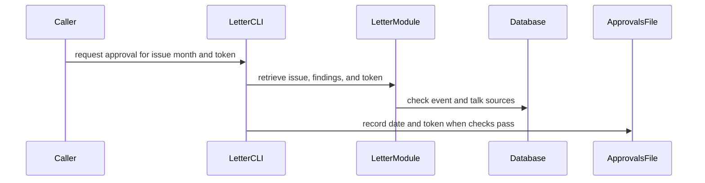

<!-- coderabbit-ai-generated:v1 -->

<!-- This is an auto-generated comment: summarize by coderabbit.ai -->
<!-- review_stack_entry_start -->

<a href="https://app.coderabbit.ai/change-stack/allthings-sf/allthingsweb/pull/429?scope=example&amp;cs_source=review_comment"><picture><source media="(prefers-color-scheme: dark)" srcset="https://storage.googleapis.com/coderabbit_public_assets/review-stack-buttons-v1/explain-change-dark.svg"><source media="(prefers-color-scheme: light)" srcset="https://storage.googleapis.com/coderabbit_public_assets/review-stack-buttons-v1/explain-change.svg"></picture></a>

<!-- review_stack_entry_end -->
<!-- recent_review_status_start -->

No actionable comments were generated in the recent review.

<!-- recent_review_status_end -->
<!-- walkthrough_start -->

<strong>Walkthrough</strong>

<dl>
<dd>
 

The PR adds a monthly letter system with issue schemas, content checks, database-backed source checks, approval-based publication, editorial edit tracking, and commands to list, show, and approve issues.

**Changes: Monthly letter workflow**

|Layer / File(s)|Summary|
|:---|:---|
|**Issue structure and content validation**   `core/src/letter.ts`, `core/tests/letter.test.ts`|Defines issue and source schemas, section order and word budgets, link and prose helpers, and content findings. Tests cover schemas, rules, source URLs, and prose helpers.|
|**Source checks, publication, and edit tracking**   `core/src/letter.ts`, `core/letters/approvals.json`, `core/letters/before-after.json`, `core/tests/letter.test.ts`|Checks event and talk sources against published database records. Publishes issues only when recorded approval tokens match current issue tokens. Adds edit counts and repeated-text findings, with tests for source, approval, and edit behavior.|
|**CLI commands and issue registry**   `core/letters/index.ts`, `core/scripts/letter.ts`, `core/package.json`, `core/README.md`, `core/tests/letter.test.ts`|Adds `list`, `show`, and `approve` commands and the package script. Documents issue validation, approval, and editorial edits. Tests check issue-file listing and consistency with rules and approvals.|

<!-- change_assessment_start -->
**Estimated code review effort:** 4 (Complex) | ~45 minutes

<!-- change_assessment_commit:"9e0bb0f04172d8727daf3a6352031dac9fd0399d" -->
<!-- change_assessment_priority:{"version":1,"urgency":"p2","manual":false} -->
**Change:** Feature
<!-- change_assessment_end -->

### Sequence Diagram(s)

</dd>
</dl>

<!-- walkthrough_end -->

<strong>Merge Risk:</strong> <strong><picture></picture> Minimal</strong> · up to <code>9e0bb</code>

<dl>
<dd>
 

<!-- final_review_risk_start -->
<!-- final_review_risk_label
**Merge Risk:** **⚪ Minimal** · up to `9e0bb`
-->
<!-- final_review_risk_coverage:{"sourceCommitId":"9e0bb0f04172d8727daf3a6352031dac9fd0399d","coveredCommitId":"9e0bb0f04172d8727daf3a6352031dac9fd0399d","kind":"reviewed"} -->

The monthly letter workflow adds validation, database-backed source checks, and token-bound approvals, and nothing is published until Erik approves the exact content. The approve command now has a read-only dry run and a token-confirmed write, which resolves the earlier concern. Nothing concrete blocks merging, but confirm CI is green first.
<!-- final_review_risk_end -->

</dd>
</dl>

<strong>Security architecture risk:</strong> <strong><picture></picture> Minimal</strong> · up to <code>9e0bb</code>

<dl>
<dd>
 

<!-- architecture_review_start -->
<!-- architecture_review_label
### Security Architecture Review

**Security architecture risk:** **⚪ Minimal** · up to `9e0bb`
-->

This adds a local editorial approval workflow without adding a public publishing endpoint. No material security or failure-containment regression was established. Human approval depends on trusted operators and control of repository changes.

**Retained concerns**
No architecture-level concerns identified.

<strong>Security review details</strong>

<dl>
<dd>
 

**Security Blast Radius**
- _inferred_ — The independently controllable scope evidenced here is repository-authored letter content and approval records, plus database facts read during approval. The new database queries are SELECTs; this change does not establish database-write authority or an external sending capability.

**Trust Boundaries and Controls**
- _observed_ — The approval token is a deterministic, truncated SHA-256 content digest, not a signature or proof of Erik's identity. The CLI instructs the operator to record only Erik's approval, but does not authenticate that decision. A trusted repository writer can construct a matching record, so the mechanism protects against content drift rather than an adversarial committer.

**Resilience and Maintainability Implications**
- _observed_ — Regression assertions cover content-change invalidation, cross-month token rejection, current-token matching for committed approvals, duplicate approval months, and letter-rule and repeated-edit checks across every issue. These assertions were inspected but not executed.

</dd>
</dl>

<!-- architecture_review_end -->

</dd>
</dl>

<!-- pre_merge_checks_walkthrough_start -->

<strong>Pre-merge checks: <picture></picture> 4</strong>

<dl>
<dd>
 

|         Check name         |                                             Status                                             | Explanation                                                                                                                                                                                               |
| :------------------------ | :--------------------------------------------------------------------------------------------: | :-------------------------------------------------------------------------------------------------------------------------------------------------------------------------------------------------------- |
|      Description Check     |  | Check skipped - CodeRabbit’s high-level summary is enabled.                                                                                                                                               |
|         Title check        |  | The title names a real part of the changeset: a model for monthly letters with voice and word-budget rules, publication gated on Erik's approval. It is long (120 characters, 22 words) and truncated mi… |
|     Linked Issues check    |  | Check skipped because no linked issues were found for this pull request.                                                                                                                                  |
| Out of Scope Changes check |  | Check skipped because no linked issues were found for this pull request.                                                                                                                                  |

<strong>Full details: Title check</strong>

<dl>
<dd>
 

**Explanation**

The title names a real part of the changeset: a model for monthly letters with voice and word-budget rules, publication gated on Erik's approval. It is long (120 characters, 22 words) and truncated mid-phrase at "Erik's y", so it is not concise. It does not mention the CLI, approvals file, or the Bun letter command, which are also main parts of the change. It captures the primary change, so it passes.

</dd>
</dl>

</dd>
</dl>

<!-- pre_merge_checks_walkthrough_end -->
<!-- finishing_touch_checkbox_start -->

<strong>Finishing Touches</strong>

<dl>
<dd>
 

<strong>Simplify code</strong>

<dl>
<dd>
 

- [ ] <!-- {"checkboxId": "f120d606-b0e2-4b7d-8316-181794555b43", "radioGroupId": "simplify-output-choice-group-unknown_comment_id"} --> Create a new PR

</dd>
</dl>

</dd>
</dl>

<!-- finishing_touch_checkbox_end -->
